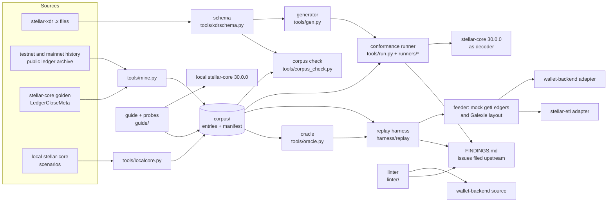

# Architecture

ShapeCov tests software that reads the Stellar ledger: indexers and the SDKs' XDR decoders. It has
a corpus of rare but valid ledgers and values, tools that build and check the corpus, and three
consumers that run it: an indexer replay harness, a cross-SDK conformance runner, and a guide
whose claims are checked against the corpus and against stellar-core itself. stellar-core is the
judge of what is valid throughout. This file describes the repository at its current commit.
Anything not built yet is marked as planned.

## The parts

**Schema and generator** (`tools/xdrschema.py`, `tools/gen.py`, `schema/`). The schema is parsed
from the stellar-xdr `.x` files at tag v30.0, not taken from any SDK. The generator walks it to
write valid values for every type, biased toward boundaries, and faulty values that each break one
XDR rule. It counts coverage in cells, which are union arms and enum members.

**Corpus and manifest** (`corpus/`). Each entry is an XDR file plus a manifest record: CAP tags,
protocol, source, a synthetic flag, expected decoded values and the cells it exercises. Real
ledgers come from three places:
- testnet and mainnet history, mined from Stellar's public ledger archive (`tools/mine.py`);
- stellar-core's golden LedgerCloseMeta files, kept byte-identical;
- a local stellar-core running fixed scenarios (`tools/localcore.py`), which regenerate byte for
  byte on both the testnet and mainnet passphrases.

`corpus/CAP-COVERAGE.md` accounts for every live CAP.

**Corpus check** (`tools/corpus_check.py`). Re-verifies every entry. It decodes the entry with the
kit's own strict decoder and re-encodes it to the same bytes, then checks hashes, expected values,
patterns and CAP tags. With `--goldens` it compares the golden entries byte for byte with
stellar-core's files. With `--sdks` and `--core` it also runs each entry through the SDK runners
and stellar-core.

**Conformance runner** (`tools/run.py`, `runners/`, `harness/sdk-semantic/`). It feeds generated
cases and corpus entries to one small runner per decoder and compares their answers with each
other and with stellar-core. The decoders are rs-stellar-xdr, js-stellar-sdk, py-stellar-base,
py-stellar-xdr, go-stellar-sdk and java-stellar-sdk. A runner that crashes loses only its current
case. The pinned-SDK checks also run the RFP's JavaScript sightings across releases, before and
after each fix.

**Replay harness** (`harness/replay/`). It replays corpus ledgers through an unmodified indexer at
a given commit, against its real database, and reports each entry as pass, mishandled or dropped.
A feeder serves the ledgers in two forms:
- a mock stellar-rpc (`getLedgers` and the methods an indexer calls first);
- the Galexie data-lake layout on an S3-compatible store.

`sightings.json` pins the RFP's sightings to pre-fix and fixed commits, and CI checks that each
fails before its fix and passes after.

**Oracle** (`tools/oracle.py`). Derives from any LedgerCloseMeta what changed in ledger state, and
each adapter's `expect.py` turns that into the rows its indexer should store. Every corpus ledger
becomes a test with no hand-written expectation. A failure is labelled with the upstream issue
that explains it (`adapters/<name>/known.json`), or reported as unexplained, which makes it a
candidate finding.

**Linter** (`linter/`). Three Go analyzers (`golang.org/x/tools/go/analysis`) for the three
ingestion mistakes the RFP names. Each has seeded-violation tests. CI runs it on wallet-backend
and fails on any finding outside `linter/accepted/wallet-backend.json`.

**Indexer-hardening guide** (`guide/`). Field tables of what stellar-core validates, with source
citations. `guide/check_guide.py` checks the tables against the corpus manifest. Each row also
carries stellar-core's own verdict:
- probes (`guide/probe_core.py`), transactions sent to a local stellar-core that break a rule or
  sit just inside it;
- or corpus ledgers in which core accepted the shape.

Publication waits on review by a stellar-core or platform engineer, which is planned.

**Protocol drill** (`protocol-drill/`). Runs the upgrade runbook in `MAINTENANCE.md` against the
next protocol's XDR and stellar-core's `test-lcm-next` goldens before the upgrade ships.

**Findings** (`FINDINGS.json`, `FINDINGS.md`, `issues/`, `corpus/evidence/`). Every failure the
tools find is triaged and filed upstream, or mapped to an issue someone else filed.
`FINDINGS.json` holds one record per finding (issue, component, severity, CAPs, reproduction,
first reporter, status); the table in `FINDINGS.md` is generated from it.
`.github/scripts/check_findings.py` checks the records and that every failure in the committed
replay results maps to one.

## The adapter interface

An adapter (`harness/replay/adapters/<name>/adapter.py`) owns only its indexer. The harness owns
the corpus, the ledger inputs and the verdict. The adapter is an executable with four verbs, each
printing one JSON object:
- `prepare`: build the indexer at a commit, unmodified;
- `up`: start its services, such as its database;
- `run`: feed it one ledger and report what it stored;
- `down`: remove everything it started.

Expectations never come from the indexer. The full contract is in `harness/replay/ADAPTER.md`.
Three adapters exist: wallet-backend (the reference), stellar-etl and Horizon. A fourth,
`adapters/example/`, wraps a toy indexer of about 100 lines in two variants, participants from the
envelope and from the meta, to show the interface and the participant rule by example.

## Isolation

The kit runs third-party code: indexers, SDKs and stellar-core. All of it runs in Docker, with no
network access or on a network that has no route to the internet:
- the Go and Java runners, stellar-core checks and local stellar-core run with `--network none`;
- a replay's feeder, database and indexer share a Docker network created with `--internal`.

The tools hold no keys or funds and need no secrets. CI runs with read-only repository
permissions. `INFRASTRUCTURE.md` lists every network connection the tools make. There is no user
tracking. [`THREAT-MODEL.md`](THREAT-MODEL.md) models the threats to the kit itself. Its checks run
in CI: images pinned by digest and actions by commit SHA, workflow permissions, and a test that the
replay network has no route to the internet (`security/`).

## What runs where

| Where | What |
|---|---|
| Any machine with Python 3.12 | schema, generator, corpus check (decoder and hashes), guide check, CAP table, oracle on committed results, `quickcheck.py` |
| The same, plus Docker | SDK runners for Go and Java, stellar-core checks, local stellar-core scenarios and guide probes, the replay harness, the linter on wallet-backend |
| CI `ci.yml`, every push and weekly | one job per RFP acceptance check (1, 3, 4, 6; and 1 with 5); see `VERIFY.md` |
| CI `replay.yml`, weekly and on changes | RFP check 2, stellar-etl replay, memory budget, reproducible local-core entries on both passphrases, the Rust sightings |
| CI `sdk-conformance.yml` (reusable) and `linter/action.yml` | the corpus through one SDK at the caller's version, and the linter on the caller's module: called by `ci.yml`, and by any other repository (`ADOPT.md`) |
| CI `release.yml`, on a tag | corpus archive, linter binaries for five platforms, `SHA256SUMS`, build provenance attestations, attached to the release |
| CI `upstream-drift.yml`, weekly | one issue per upstream release newer than the pins, with the runbook checklist |

## Planned, not built

- Replay adapters beyond wallet-backend, stellar-etl and Horizon.
- Review and publication of the guide.
- Whole-ledger generation from the generator's cases. Today generated cases are checked by
  decoders only, and whole ledgers come from fixed local-core scenarios.
- Coverage of the schema cells no generated valid case reaches yet (`out/REPORT.md` lists them).
