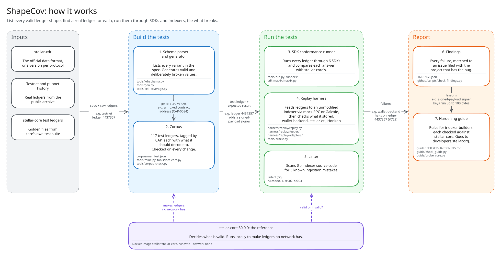

# Architecture

## Problem

Indexers and SDKs break on rare but valid ledger data. Each team finds these cases alone, usually in production:

- wallet-backend stopped ingesting on a signed-payload signer ([#729](https://github.com/stellar/wallet-backend/pull/729)).
- A liquidity-pool bug fixed in Go and JavaScript came back in Python ([#1246](https://github.com/StellarCN/py-stellar-base/issues/1246)).
- One audit of stellar-etl filed 17 correctness issues ([#448](https://github.com/stellar/stellar-etl/issues/448)).

No tool tells a team which valid ledger shapes its code has never been tested against.

## Goals

- **Measure coverage from the XDR schema.** Every union arm and enum value is a cell. Uncovered cells are also listed.
- **Use real ledgers.** Use Mainnet and Testnet to grab ledgers, and only generate synthetic data when network has not produced a variant, and mark it synthetic.
- **stellar-core is the refrence of the XDR format.** No SDK is the reference.
- **Test software as it ships.** Unmodified indexers, real databases, the inputs they read in production.
- **Every failure ends as an upstream issue.**
- **Run anywhere.** Offline, in CI, with no keys, funds or hosted service.
- **Follow protocol upgrades.** A new protocol shows up as new uncovered cells.

## Non-goals

- A hosted service or monitoring tool.
- Testing stellar-core.
- Testing smart-contract logic.
- Fixing indexers and SDKs. We file issues and may offer patches; maintainers decide.

## Proposed solution

ShapeCov works in four steps. The drawing below shows them from left to right.

- **List every shape.** We parse the XDR definitions and list every variant a ledger can contain: each operation type, address type, result code and so on. Each variant is a "cell". Coverage is the share of cells that have a test ledger.
- **Find a ledger for each shape.** For each cell we take a real ledger from testnet or mainnet history, or from stellar-core's own test files. If no network has produced it yet, a local stellar-core makes it, or we generate it and mark it synthetic. Each ledger is saved with its CAP tags and what it should decode to. This set of ledgers is the corpus.
- **Run the corpus against real software.**
    - SDKs: every ledger goes through six SDK decoders. An answer that differs from stellar-core's is a bug.
    - Indexers: wallet-backend, stellar-etl or Horizon ingest the ledgers, unmodified, from a mock RPC node or a mock Galexie data lake. We compare what they stored with what the ledger says they should have stored.
    - Source code: a linter flags three known ingestion mistakes in Go indexers.
- **Report what breaks.** Every failure is filed as an issue with the project that has the bug, or matched to an existing issue. The lessons go into a hardening guide for indexer builders.

Source: [`architecture.excalidraw`](architecture.excalidraw). Open it in Excalidraw to edit.

### Components

| Component | What it does | Where |
| --- | --- | --- |
| Schema and generator | Parses stellar-xdr into 477 types and lists every cell. Generates valid edge cases, and invalid ones that each break one XDR rule. | [`tools/`](tools/), [`schema/`](schema/) |
| Corpus | 117 entries, 114 real. Each has CAP tags, protocol, source and expected decoded values. Sources: testnet and pubnet history, stellar-core golden files, local stellar-core runs that reproduce byte for byte. | [`corpus/`](corpus/) |
| Corpus check | Decodes and re-encodes every entry with our own decoder, and compares golden entries with stellar-core's files. | [`tools/corpus_check.py`](tools/corpus_check.py) |
| Conformance runner | Runs every case and entry through rs-stellar-xdr, js-stellar-sdk, py-stellar-base, py-stellar-xdr, go-stellar-sdk and java-stellar-sdk, and compares each with stellar-core. A matrix shows which SDKs share a defect. | [`runners/`](runners/), [`sdk-matrix/`](sdk-matrix/) |
| Replay harness | Runs an unmodified indexer at any commit on its real database. Expected rows are computed from the ledger, never from the indexer. Each entry is pass, mishandled or dropped. | [`harness/replay/`](harness/replay/) |
| Linter | Three Go checks, one per ingestion mistake in the RFP. Also a GitHub Action. | [`linter/`](linter/) |
| Hardening guide | What stellar-core validates and what an indexer must check itself. Each row is tested against stellar-core 30.0.0. Not published until a core engineer reviews it. | [`guide/`](guide/) |
| Findings | One record per failure, each mapped to an upstream issue. CI fails on any failure without one. | [`FINDINGS.md`](FINDINGS.md) |

**Bugs across ledgers** are caught by replaying sequences of consecutive ledgers into one database and checking the end state ([`corpus/sequences.json`](corpus/sequences.json)).

### Adapter interface

An indexer plugs in through an adapter with four commands, each printing one JSON object:

- `prepare`: build the indexer at a commit, unmodified.
- `up`: start its services, such as its database.
- `run`: feed it one ledger or sequence, and report what it stored.
- `down`: remove everything it started.

The adapter never decides what is correct. Its `expect.py` maps the computed ledger changes to the indexer's rows, and `known.json` maps each failure to its upstream issue. Adapters exist for wallet-backend, stellar-etl and Horizon. Full contract: [`harness/replay/ADAPTER.md`](harness/replay/ADAPTER.md).

### Stellar integration

Offchain only. Targets protocol 30, stellar-xdr v30.0 and stellar-core 30.0.0.

| Stellar component | Use |
| --- | --- |
| stellar-xdr | Source of the schema and of what each protocol adds. |
| stellar-core | Reference for validity. Its golden ledgers and local runs feed the corpus. |
| Testnet and pubnet history | Real ledgers, protocols 8 to 30. |
| Six SDK decoders | Tested against every case and entry. |
| stellar-rpc | Mocked `getLedgers`, so indexers ingest as from a live node. |
| Galexie | Corpus served in its data-lake layout, on S3 and GCS. |
| wallet-backend, stellar-etl, Horizon | Run unmodified against the corpus. |
| go-stellar-sdk | Indexers built on it are linted. |
| developers.stellar.org | Target for the guide ([review request](https://github.com/stellar/stellar-docs/issues/3165)). |

### Isolation and security

- No hosted service, no user tracking, no keys or funds. Every network connection is listed in [`INFRASTRUCTURE.md`](INFRASTRUCTURE.md).
- Third-party code runs in Docker with no route to the internet: `--network none` for SDK runners and stellar-core, an `--internal` network for replays. CI checks this.
- Images pinned by digest, Actions by commit SHA.
- STRIDE threat model: [`THREAT-MODEL.md`](THREAT-MODEL.md).
- Nothing central to decentralize. Teams run it in their own CI through a reusable workflow and the linter Action ([`ADOPT.md`](ADOPT.md)).

### Protocol upgrades

A new protocol appears as uncovered cells and failing checks. The runbook is in [`MAINTENANCE.md`](MAINTENANCE.md): start at the new stellar-xdr tag, finish before the mainnet vote.

Rehearsed on the next protocol ([`protocol-drill/REPORT.md`](protocol-drill/REPORT.md)): stellar-xdr `next` needs no schema change, and all 15,306 `test-lcm-next` golden ledgers decode today. The pending `lcm_v3` change adds one cell.

A weekly job opens an issue for each new upstream release.