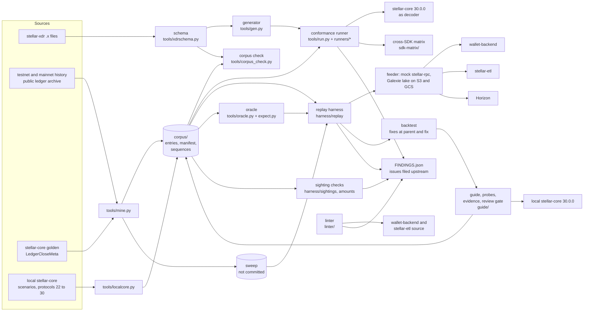

# Architecture

ShapeCov tests software that reads the Stellar ledger: indexers and the SDKs' XDR decoders. It has
a corpus of rare but valid ledgers and values, tools that build and check the corpus, and the
consumers that run it: an indexer replay harness with three indexer adapters, a cross-SDK
conformance runner and defect matrix, checks for the RFP's sightings outside the indexers, and a
guide whose claims are checked against the corpus and against stellar-core itself. stellar-core is
the judge of what is valid throughout. This file is a map of the repository at its current commit:
what each part is, what it reads and writes, and which check proves it. Anything not built yet is
marked as planned.

## The parts

**Schema and generator** (`tools/xdrschema.py`, `tools/gen.py`, `schema/`). The schema is parsed
from the stellar-xdr `.x` files at tag v30.0, not taken from any SDK. The generator walks it to
write valid values for every type, biased toward boundaries, and faulty values that each break one
XDR rule. It counts coverage in cells, which are union arms and enum members
(`tools/cell_coverage.py`; `tools/cell_protocols.py` dates each cell to the stellar-xdr release
that introduced it). Proved by the unit tests (`tests/test_xdrschema.py`, `tests/test_codec.py`).

**Corpus and manifest** (`corpus/`). Each entry is an XDR file plus a manifest record: CAP tags,
protocol, source, a synthetic flag, expected decoded values and the cells it exercises. Real
ledgers come from three places:
- testnet and mainnet history, mined from Stellar's public ledger archive (`tools/mine.py`);
- stellar-core's golden LedgerCloseMeta files, kept byte-identical;
- a local stellar-core running fixed scenarios (`tools/localcore.py`).

Each local-core scenario starts a fresh standalone stellar-core in Docker with no network, builds
its transactions with the kit's own encoder and signer (no SDK), and writes core's own meta. Keys
and close times are fixed, so a scenario regenerates the same ledgers byte for byte
(`tools/localcore_repro.py` checks this on both the testnet and mainnet passphrases, after
normalizing the two things core itself does not keep stable: the order of changes within one list
and a wall-clock metric). A scenario's protocol is chosen for what it must reach: protocol 22 on
stellar-core 22.2.1 for shapes later releases refuse to produce; protocol 28 for ledgers that
indexer commits pinning go-stellar-sdk v0.7.3, which cannot decode protocol 29 or 30, must read;
protocol 30 otherwise. `tools/corpus_add.py` adds an entry and derives every field it can;
`tools/corpus_refresh_local.py` replaces local-core entries with a fresh run, keeping the
hand-written fields.

`corpus/sequences.json` names runs of consecutive corpus ledgers that an indexer must ingest into
one database (see "Sequences" below). `corpus/CAP-COVERAGE.md` accounts for every live CAP.
`tools/census.py` counts how often each named pattern occurs in a sample of network ledgers and the
largest sizes seen, for the caps the guide sets (`corpus/CENSUS.md`).

**Corpus check** (`tools/corpus_check.py`). Re-verifies every entry. It decodes the entry with the
kit's own strict decoder and re-encodes it to the same bytes, then checks hashes, expected values,
patterns and CAP tags. With `--goldens` it compares the golden entries byte for byte with
stellar-core's files. With `--sdks` and `--core` it also runs each entry through the SDK runners
and stellar-core. CI: "RFP check 1" and the conformance job.

**Conformance runner** (`tools/run.py`, `runners/`, `harness/sdk-semantic/`). It feeds generated
cases and corpus entries to one small runner per decoder and compares their answers with each
other and with stellar-core. The decoders are rs-stellar-xdr, js-stellar-sdk, py-stellar-base,
py-stellar-xdr, go-stellar-sdk and java-stellar-sdk. A runner that crashes loses only its current
case. The pinned-SDK checks (`harness/sdk-semantic/`) run the corpus through each SDK's own
helpers (asset ordering and pool IDs, sorted maps, maps to native values, ID builders, memo text)
on every installed release, before and after each fix. `sdk-conformance.yml` is the same run as a
reusable workflow, for any repository at any SDK version (`ADOPT.md`). CI: the conformance job and
the two reusable-workflow jobs.

**Cross-SDK defect matrix** (`sdk-matrix/matrix.py`, writes `sdk-matrix/MATRIX.md` and
`matrix.json`). One row per defect class found in one SDK, one column per decoder, saying whether
the others have it. Two kinds of row: XDR codec faults, where every faulty case of that kind the
generator made runs through every runner and the cell counts how many the decoder accepted (with
stellar-core's column from its recorded run); and behaviour above the codec, from the pinned-SDK
checks, where the cell names the first release that passes. A cell is filled only from a run of the
script or from a release, changelog or merged pull request it names; otherwise it says "not
tested". The script needs the six runners built and Docker, so it is run by hand; the unit tests
(`tests/test_matrix.py`) check its rendering.

**Replay harness** (`harness/replay/`). It replays corpus ledgers through an unmodified indexer at
a given commit, against its real database, and reports each entry as pass, mishandled or dropped.
`replay.py` has five verbs: `run` (replay entries or a sequence), `report` (write the results
page), `check` (judge recorded results with the oracle, and fail on an unexplained failure or on a
recorded ledger that is no longer in the manifest), `rejudge` (judge recorded observations again
under the current oracle without running the indexer), and `backtest` (below). A feeder serves the
ledgers, streaming from disk within a fixed memory budget (`memcheck.py` serves a 600 MB
corpus within 64 MB), in three forms:
- a mock stellar-rpc (`getLedgers` and the methods an indexer calls first);
- the Galexie data-lake layout on an S3-compatible store;
- the same lake through the GCS JSON and XML APIs.

Each run's containers are named from `REPLAY_PREFIX`, so runs can go side by side.
`sightings.json` pins the RFP's wallet-backend sightings to pre-fix and fixed commits. Results are
written to `out*/<commit>/<input>/<entry>/` (an observation and the indexer's logs per ledger) and
`results.jsonl`; `RESULTS*.md` is generated from them, and `SHAPES.md` (`shapes.py`) rolls the
results up per corpus shape.

The three indexer adapters:

| Adapter | Runs | Reads | Inputs | Sequences | Results | CI |
|---|---|---|---|---|---|---|
| `wallet-backend` (the reference) | `ingest` at any commit, against TimescaleDB | transactions, operations, participants, state changes, balances, contract and protocol tables | rpc and data lake | yes | `out/`, `out-sequences/` | replay: sightings |
| `stellar-etl` | its `export_*` commands at any commit | transactions, operations, effects, token transfers, contract events, trades, ledger entry changes | data lake over GCS (the only datastore it supports) | yes; entry changes are exported only over a range of two or more ledgers (stellar-etl#515), so they are checked on sequences | `out-stellar-etl/`, `out-stellar-etl-sequences/` | replay: stellar-etl |
| `horizon` | `db reingest range` at a release tag, against PostgreSQL | history transactions, operations, effects, participants, trades | data lake over S3 | no; one ledger at a time | `out-horizon/` | replay: horizon (three ledgers, same verdicts as recorded) |

A fourth, `adapters/example/`, wraps a toy indexer in two variants, participants from the envelope
and from the meta, to show the interface and the participant rule by example.

**Sequences** (`corpus/sequences.json`, `replay.py run --sequence NAME`). Some defects show only
across ledgers: a trustline removed and added again within one ledger after it was created in the
one before, a contract that rebinds itself to other wasm after it was classified, a balance
created in one ledger and changed in the next. A single-ledger replay starts from an empty
database each time and cannot see them. A sequence is served as one window, the indexer ingests
every ledger into one database in one run, and the harness judges each ledger and then the
indexer's state at the end (the oracle's `end_state_expectations`, and the sequence's own
expectations in the manifest). Each sequence records which fix it was built for and whether it is
blind: none is, since each was built after reading the fix it tests.

**Protocol production** (wallet-backend). wallet-backend indexes SEP-41 tokens and Blend only once
an operator has run its `protocol-setup` and the protocol cursors exist. The adapter does what the
operator does, with the commit's own command, and sets the cursors to the ledger before the
replay; a sequence may choose which protocols and cursors. `run --protocols none` turns it off, and
a commit older than `protocol-setup` has nothing to turn on. Nothing is injected into the indexer's
database or validators: classification is its ordinary live-ingestion path. The mock RPC holds no
ledger state, so only contracts whose wasm is uploaded in the replayed ledgers are classified, and
token metadata falls back to the defaults wallet-backend uses when that call fails.
`tools/rebind_token_wasm.py` assembles the purpose-built token the rebind sequences deploy.

**Commit boundaries** (wallet-backend). When it is behind, wallet-backend commits several ledgers
in one batch, and which ledgers share a batch depends on timing. A sequence's `commits` fixes the
boundaries: the feeder releases the sequence's ledgers in steps, and the adapter keeps one commit
open while the next group is processed, as a slow commit does in production. This is a timing
control only, applied the same way at a fix and at its parent; the indexer's code, configuration
and input bytes are untouched.

**Oracle** (`tools/oracle.py`, `adapters/<name>/expect.py`, `classify.py`). Derives from any
LedgerCloseMeta what changed in ledger state, and each adapter's `expect.py` turns that into the
rows its indexer should store: per transaction and operation, participants (from the meta, not the
envelope), events, ledger-level rows such as trades with the protocol's own pool formulas, and the
end state after a sequence. `classify.py` compares the observation with those rows. Every corpus
ledger becomes a test with no hand-written expectation. A failure is labelled with the upstream
issue that explains it (`adapters/<name>/known.json`), or reported as unexplained, which makes it a
candidate finding. Where an indexer's documented choice differs from the oracle's default (Horizon
records a failed transaction's envelope addresses as participants), the adapter declares it in
`expect.py` and the report says so.

**Backtest** (`harness/replay/backtest.json`, `BACKTEST.md`, `replay.py backtest`). The RFP's
acceptance check for the harness, applied to the 2026 bug history of wallet-backend and
stellar-etl: for every fix that concerns a ledger shape, the corpus is replayed at the commit
before the fix and at the fix, judged by the oracle only, and the fix is recorded as detected
(failures that bear on it at the parent, none at the fix), missed, or out of scope, with the reason.
Each detection says whether it is blind. Pass 1 is the corpus; pass 2 adds blind ledgers from the
sweep. `replay.py backtest` checks every row against the recorded results in
`harness/replay/backtest/` and the `out*` directories (CI: replay: backtest, and the quick check).

**Sweep** (`harness/replay/sweep.py`). Ordinary traffic, not committed: `tools/mine.py scan`
indexes a stride of pubnet and testnet ledgers from the public archive, `sweep.py build` writes them
as a corpus directory in the corpus layout, and `replay.py run --corpus DIR --all-entries` replays
them through an adapter with the oracle. A ledger that shows something new is added to `corpus/`
on its own. The sweep's figures are in `harness/replay/README.md`; its ledgers also feed the
backtest's pass 2 and the census.

**Sighting checks outside the indexers** (`harness/sightings/`, and one stellar-etl check).
`harness/sightings/README.md` is the scoreboard for each of the RFP's 18 sightings: reproduced and where
it runs in CI, or why it cannot be. Besides the indexer replays and the pinned-SDK checks:
- `harness/sightings/run.sh` builds a probe against the Rust release before and after each fix
  (rs-stellar-xdr#598, rs-soroban-sdk#2099; CI: replay: sightings-rust);
- `harness/sightings/js-xdr-165/check.cjs` runs the issue's own cases on js-xdr as pinned and
  fails if one stops behaving as the issue shows; the weekly run installs the newest published
  release and fails once a release carries the fix (CI: ci, on every push and weekly);
- `harness/replay/adapters/stellar-etl/amounts_check.py` reads the recorded stellar-etl exports of
  one ledger with amounts above 2^53 stroops and compares each exported amount, read back exactly,
  with the ledger's own amount (stellar-etl#454; CI: replay: stellar-etl, and the quick check).

**Linter** (`linter/`). Three Go analyzers (`golang.org/x/tools/go/analysis`) for the three
ingestion mistakes the RFP names. Each has seeded-violation tests (`linter/testdata/`). CI runs it
on wallet-backend and on stellar-etl and fails on any finding outside `linter/accepted/<target>.json`;
the reports are recorded in `linter/results/`. `linter/action.yml` runs it on any Go module.

**Indexer-hardening guide** (`guide/`). Field tables of what stellar-core validates, with source
citations, then caps, participants, addresses and a checklist. `guide/check_guide.py` checks:
- the tables against the corpus manifest;
- stellar-core's own verdict for every row (`verdicts.json`): probes (`probe_core.py`,
  `probes.json`), transactions sent to a local stellar-core that break a rule or sit just inside
  it, or corpus ledgers in which core accepted the shape;
- the checklist's evidence (`evidence.json`, `evidence.py`): each item names the backtest fixes and
  finding records where an indexer, SDK or exporter made that mistake, and the corpus entries or
  sequences that exercise it. The table under the checklist is generated from it, and the check
  fails if an id does not resolve or a detected fix maps to no item;
- the review gate (`review.py`): the guide carries one review line, empty until a stellar-core or
  platform engineer has reviewed it. `export_docs.py` writes the developers.stellar.org page
  (`guide/stellar-docs/`); while the line is empty the page opens with a not-reviewed caution, and
  once it is filled, with a line naming the reviewer and the commit reviewed. The check fails if the
  page and the line disagree. `REVIEW.md` is the reviewer's brief, with a generated list of the
  sides whose verdict rests on a source citation alone.

CI: "RFP check 4", which also reruns the probes.

**Protocol drill** (`protocol-drill/`). Runs the upgrade runbook in `MAINTENANCE.md` against the
next protocol's XDR and stellar-core's `test-lcm-next` goldens before the upgrade ships
(`REPORT.md`, `drill.json`; `tests/test_drill.py`).

**Findings** (`FINDINGS.json`, `FINDINGS.md`, `issues/`, `corpus/evidence/`). Every failure the
tools find is triaged and filed upstream, or mapped to an issue someone else filed.
`FINDINGS.json` holds one record per finding (issue, component, severity, CAPs, reproduction,
first reporter, status); the table in `FINDINGS.md` is generated from it.
`.github/scripts/check_findings.py` checks the records and that every failure in the committed
replay results of every adapter maps to one (CI: "RFP check 6").

**Quick check and figures** (`quickcheck.py`, `.github/scripts/check_counts.py`). `quickcheck.py`
runs, in parallel and without Docker or network, the checks that work on recorded evidence: one
line per RFP check, plus CAP coverage, shapes, the example adapter, the backtest, the notice, the
documents' figures and security; `--full` adds the mutant and unit tests. CI runs it as a reviewer
would. `check_counts.py` checks every figure the top-level documents state (corpus size, findings,
backtest totals, linter findings, sightings and others) against the files they come from.

## The adapter interface

An adapter (`harness/replay/adapters/<name>/adapter.py`) owns only its indexer. The harness owns
the corpus, the ledger inputs and the verdict. The adapter is an executable with four verbs, each
printing one JSON object:
- `prepare`: build the indexer at a commit, unmodified;
- `up`: start its services, such as its database;
- `run`: feed it one ledger, or one sequence, and report what it stored;
- `down`: remove everything it started.

Expectations never come from the indexer. An adapter's `expect.py` maps the oracle's ledger-state
changes to the indexer's rows through optional hooks (`expectations`, `participant_expectations`,
`event_expectations`, `ledger_expectations`, `end_state_expectations`, `manifest_expectations`),
and its `known.json` maps failing checks to upstream issues. The full contract is in
`harness/replay/ADAPTER.md`.

## Isolation

The kit runs third-party code: indexers, SDKs and stellar-core. All of it runs in Docker, with no
network access or on a network that has no route to the internet:
- the Go and Java runners, stellar-core checks and local stellar-core run with `--network none`;
- a replay's feeder, database and indexer share a Docker network created with `--internal`.

The tools hold no keys or funds and need no secrets. CI runs with read-only repository
permissions. `INFRASTRUCTURE.md` lists every network connection the tools make. There is no user
tracking. [`THREAT-MODEL.md`](THREAT-MODEL.md) models the threats to the kit itself. Its checks run
in CI: images pinned by digest and actions by commit SHA, workflow permissions, and a test that the
replay network has no route to the internet (`security/`).

## What runs where

| Where | What |
|---|---|
| Any machine with Python | `quickcheck.py` on 3.9 to 3.14, which CI runs on both: corpus check (decoder and hashes), guide check, CAP table, oracle on recorded results, backtest check; with 3.12, as CI runs them, also the schema and the generator |
| The same, plus Docker | SDK runners for Go and Java, stellar-core checks, local stellar-core scenarios and guide probes, the replay harness and the sweep, the linter, the cross-SDK matrix |
| CI `ci.yml`, every push and pull request, and weekly | one job per RFP acceptance check (1, 3 on both indexers, 4, 6; and 1 with 5), the quick check, the documents' figures, unit tests, security, the reusable workflow and linter action as a caller uses them, js-xdr#165; `replay.yml` is called from it when a replay path changes; one `green` job passes only when every job has |
| CI `replay.yml`, weekly, on demand and from `ci.yml` | RFP check 2, stellar-etl replay with the #454 amounts check, Horizon on three ledgers, memory budget, reproducible local-core entries on both passphrases, the Rust sightings, the backtest |
| CI `sdk-conformance.yml` (reusable) and `linter/action.yml` | the corpus through one SDK at the caller's version, and the linter on the caller's module: called by `ci.yml`, and by any other repository (`ADOPT.md`) |
| CI `release.yml`, on a tag | refuses a tag whose commit is not on `main` with a passing `green`; then the corpus archive, linter binaries for five platforms, `SHA256SUMS` and build provenance attestations, attached to the release |
| CI `upstream-drift.yml`, weekly | one issue per upstream release newer than the pins, with the runbook checklist |

## Planned, not built

- Replay adapters beyond wallet-backend, stellar-etl and Horizon, and sequences through Horizon.
- Review and publication of the guide.
- Whole-ledger generation from the generator's cases. Today generated cases are checked by
  decoders only, and whole ledgers come from fixed local-core scenarios.
- A rebind token built from the soroban-sdk token example in place of the purpose-built contract.
- Coverage of the schema cells no generated valid case reaches yet (`out/REPORT.md` lists them).
