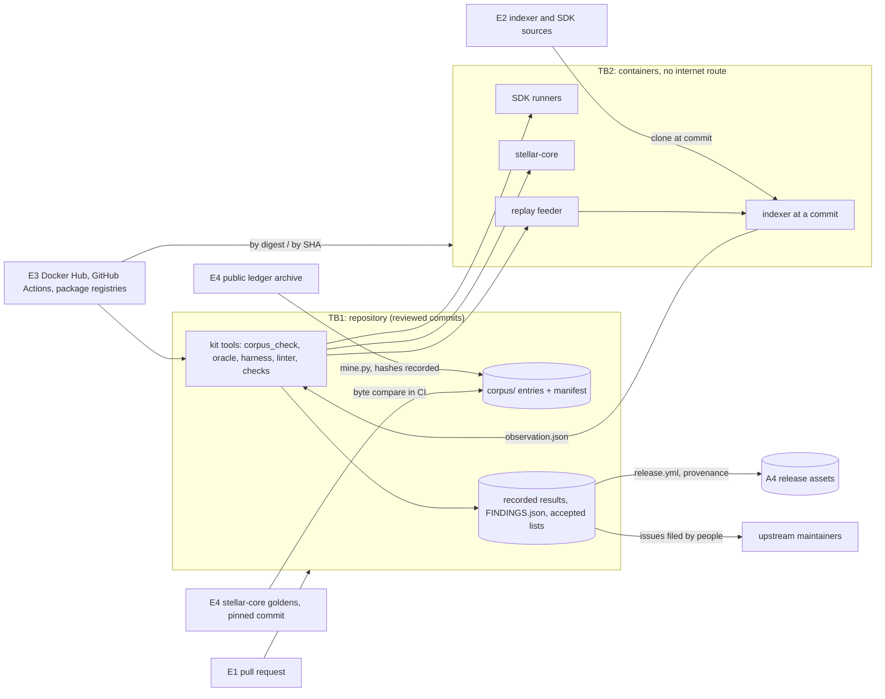

# Threat model

A STRIDE threat model of ShapeCov itself, in the form of SDF's
[Threat Modeling Readiness guide](https://developers.stellar.org/docs/build/security-docs/threat-modeling)
and its STRIDE template: what we are working on, what can go wrong, what we do about it, and whether
we did a good job. It covers the kit and the machines that run it, not the software the kit tests.
Defects the kit finds in that software are handled by [`SECURITY.md`](SECURITY.md).

Each mitigation names where it can be checked. Most are checked by a command:
`python3 security/check.py` (static, also in `quickcheck.py`), `python3 security/isolation.py`
and `python3 security/images.py verify` (both need Docker; CI runs them). Written 16 November 2026
against the repository at that date. Redo it when a component, a data source or a workflow is
added.

## 1. What are we working on?

ShapeCov is a repository of tools, not a service. It runs on a developer's machine or on GitHub's
hosted runners, holds no keys or funds and needs no secrets (`INFRASTRUCTURE.md`). It:
- builds a corpus of ledger data from public sources and checks every entry;
- runs third-party code against that corpus (indexers at a given commit, six SDK decoders, and
  stellar-core) and records verdicts;
- publishes findings, a guide and release assets that other people act on.

**What it protects**

| Asset | Why it matters |
|---|---|
| A1. The machine or CI runner that runs the kit, and the workflow token | Third-party code runs on it. |
| A2. The integrity of the corpus (entries and manifest) | Every verdict rests on the corpus being what it claims to be. |
| A3. The integrity of the verdicts: replay results, findings, the linter's accepted lists, the guide's stellar-core verdicts | Maintainers act on them; a wrong verdict wastes their time or hides a defect. |
| A4. Release assets and their provenance | Other repositories download the corpus archive and the linter binaries. |
| A5. Undisclosed exploitable defects the kit may find | Publishing one before a fix would harm Stellar users. |

**Who can attack it**

| Entity | Example |
|---|---|
| E1. A contributor opening a pull request | a corpus entry that is not what it claims; code that changes a recorded verdict; a workflow change |
| E2. Code under test | a compromised indexer commit or SDK release that tries to reach the network, escape its container or exhaust the runner |
| E3. The supply chain | a Docker image or a GitHub Action replaced under the same tag; a malicious package version |
| E4. Data sources | Stellar's public ledger archive and stellar-core's golden files, if either served altered data |

**Trust boundaries**
- TB1, the repository: what is committed has been through review. Pull requests are outside it.
- TB2, the containers: third-party code runs inside, with no network (`--network none`) or a Docker
  network created with `--internal`.
- TB3, the supply chain: images, actions and packages are fetched from outside. Images are pinned
  by digest, actions by commit SHA.
- TB4, data sources: ledger data comes from outside and is checked against its own hashes and,
  for goldens, against stellar-core's files.

## 2. What can go wrong?

| Threat | Issues |
|---|---|
| **S**poofing | **Spoof.1** A corpus entry claims a source it does not have (a "real testnet ledger" that was edited), so a defect found on it is not real.   **Spoof.2** An image or action is replaced upstream under the same tag (`golang:1.26`, `actions/checkout@v4`), so different code runs under a trusted name. |
| **T**ampering | **Tamper.1** A pull request edits recorded results, a `known.json` rule or an accepted list so that a real failure no longer shows.   **Tamper.2** Entry bytes change after they were recorded.   **Tamper.3** Release assets are replaced after publication.   **Tamper.4** A tag moves upstream and what CI runs changes with no commit. |
| **R**epudiation | **Repudiate.1** A verdict cannot be traced to the exact indexer commit, image, corpus entry and input that produced it.   **Repudiate.2** A public claim about an upstream defect turns out wrong, and the correction is lost. |
| **I**nformation disclosure | **Info.1** An exploitable defect the kit finds is published (an issue, a corpus entry) before it is fixed.   **Info.2** Recorded evidence leaks who ran the kit and where (home directories, user names).   **Info.3** Pull-request code gets the workflow token. |
| **D**enial of service | **DoS.1** A malformed corpus entry or tool input makes a kit tool hang or exhaust memory (an absurd length prefix, deep nesting).   **DoS.2** Code under test exhausts the runner: memory, CPU or time.   **DoS.3** An outside source stops serving (archive, registry), and the kit cannot rebuild. |
| **E**levation of privilege | **Elevation.1** Code under test reaches the internet or escapes its container.   **Elevation.2** Pull-request code gains write access to the repository through a workflow.   **Elevation.3** A compromised action runs with the workflow's token. |

## 3. What are we going to do about it?

| Issue | Mitigation | Where it is checked |
|---|---|---|
| Spoof.1 | **R.1** Each network entry's source record (sequence, ledger hash, close time, protocol) is checked against its bytes. **R.2** Golden entries are compared byte for byte with stellar-core's files at a pinned commit. **R.3** Local stellar-core entries regenerate identically on both passphrases. | `tools/corpus_check.py` (quick check, CI › RFP check 1); `replay` › local-core reproducibility |
| Spoof.2 | **R.1** Every image the code names is pinned by digest in one file; `pull` fetches by digest and tags locally. **R.2** Every action is pinned to a commit SHA, from GitHub's own `actions/` only. | `security/images.lock.json`; `security/check.py` (quick check, CI); `security/images.py verify` |
| Tamper.1 | **R.1** Every failure in the recorded replays must map to a finding record with an upstream link or be a claimed sighting; a `known.json` label names its issue in the output, so no rule hides a failure silently. **R.2** `replay.py check` recomputes every verdict from the stored observations. **R.3** CODEOWNERS names the three project leads for every path. | CI › RFP check 6, RFP check 2; `tests/` (the checkers' own tests). **Open:** see section 4 |
| Tamper.2 | **R.1** Each entry's SHA-256 and size are in the manifest and checked. | `tools/corpus_check.py` |
| Tamper.3 | **R.1** Releases carry `SHA256SUMS` and GitHub build provenance attestations. | `release.yml`; `gh attestation verify <asset> -R ABS-gmbh/shapecov` |
| Tamper.4 | **R.1** Pins as in Spoof.2. **R.2** A weekly job reports upstream releases newer than the pinned versions; `images.py drift` reports moved image tags. | `upstream-drift.yml`; `security/images.py drift` |
| Repudiate.1 | **R.1** Every replay records the indexer commit, its build image, dependency pins, the input and the job (`runs.jsonl`, `job.json`, evidence directories). **R.2** `STATUS.md` is generated from git history; releases are attested. | `harness/replay/out*/`; `STATUS.md` |
| Repudiate.2 | **R.1** Each finding carries its status and date in `FINDINGS.json`, and corrections stay in the record (E1's impact was corrected on the issue and in the record). | CI › RFP check 6 |
| Info.1 | **R.1** `SECURITY.md`: exploitable defects are reported privately, through SDF's bug bounty for SDF projects, and no corpus entry reproduces one until it is fixed. This is a policy: no command can check it. | `SECURITY.md` |
| Info.2 | **R.1** Replay jobs record the work directory as `$REPLAY_WORK`, not its path. **R.2** No recorded file names a home directory. | `security/check.py` |
| Info.3 | **R.1** No workflow runs on `pull_request_target`. **R.2** No `run:` script interpolates `github.event.*` or `github.head_ref`; such values pass through `env:`. **R.3** No workflow references a secret; the two that write use the job's own token. | `security/check.py` |
| DoS.1 | **R.1** The kit's decoder checks every length against the bytes that remain, so a length prefix cannot make it allocate more than the input. **R.2** SDK runners are separate processes with a per-batch timeout; a crash or hang loses only that case. **R.3** The replay feeder runs with 256 MB and is tested on a 600 MB corpus. | `tools/decode.py`; `tools/run.py`; `replay` › memory budget |
| DoS.2 | **R.1** Containers run with memory and CPU caps (2 GB and 2 CPUs for SDK runners, 2 GB per indexer run) and a per-job timeout; every CI job has `timeout-minutes`. | `tools/run.py`, the adapters, `.github/workflows/` |
| DoS.3 | **R.1** Corpus entries are committed, so checking them needs no outside source. **R.2** Goldens are fetched at a pinned commit. | `corpus/`; CI › RFP check 1 |
| Elevation.1 | **R.1** Third-party code runs with `--network none` or on a network created with `--internal`; every network the code creates is `--internal`. **R.2** A test starts a container on such a network and fails if it can resolve a name or open a connection to the internet, with a control on the default network. **R.3** Sources are mounted read-only where the tool only reads them. | `security/check.py`; `security/isolation.py` (CI); the adapters |
| Elevation.2 | **R.1** Workflows default to no permissions or read-only. Only `release.yml` (contents, id-token, attestations) and `upstream-drift.yml` (issues) can write, and neither runs on a pull request. | `security/check.py`; `INFRASTRUCTURE.md` |
| Elevation.3 | **R.1** As Spoof.2 R.2. | `security/check.py` |

## 4. Did we do a good job?

Writing the model found five things the repository did not have before:
- Two image tags, `golang:1.26` and `golang:1.27`, had moved upstream since this machine pulled
  them, so two machines could build with different Go patch releases. Images are now pinned by
  digest, and `images.py verify` reports a local tag that differs from the lock.
- Actions were used by tag. They are now pinned to commit SHAs.
- Nothing tested that the replay network has no internet route; `security/isolation.py` does now.
- Nothing checked recorded evidence for home-directory paths; `security/check.py` does now.
- The `main` branch has **no branch protection**. CODEOWNERS names reviewers, but nothing requires
  a review or a passing CI run before a change lands, so Tamper.1 R.3 is a convention, not a
  control. Branch protection is a repository setting, not something a file in this repository
  can enforce; turning it on is the maintainers' decision.

Accepted or not yet mitigated:
- **Container escape** through a kernel or Docker defect. GitHub's hosted runners are single-use
  virtual machines; on a developer's machine, Docker's isolation is the limit.
- **Images named by the code under test.** The stellar-etl adapter builds with the Go image that
  stellar-etl's own Dockerfile names, and the wallet-backend adapter uses the database image its
  `docker-compose.yaml` names. For the pinned commits these are in the lock. A new commit that
  names a new tag would pull it by tag; `images.py verify` would not list it, and `check.py` does
  not see it, because it is not in this repository's code.
- **Registry availability.** A digest pin fails closed if the registry stops serving the image.
- **The decoder's depth.** `tools/decode.py` has no depth cap of its own; Python's recursion limit
  stops a value nested deeper than about 1,000 levels with an error, not a hang.
- **Package versions inside the SDK runners** are pinned by lockfile or exact version, not by
  hash.
